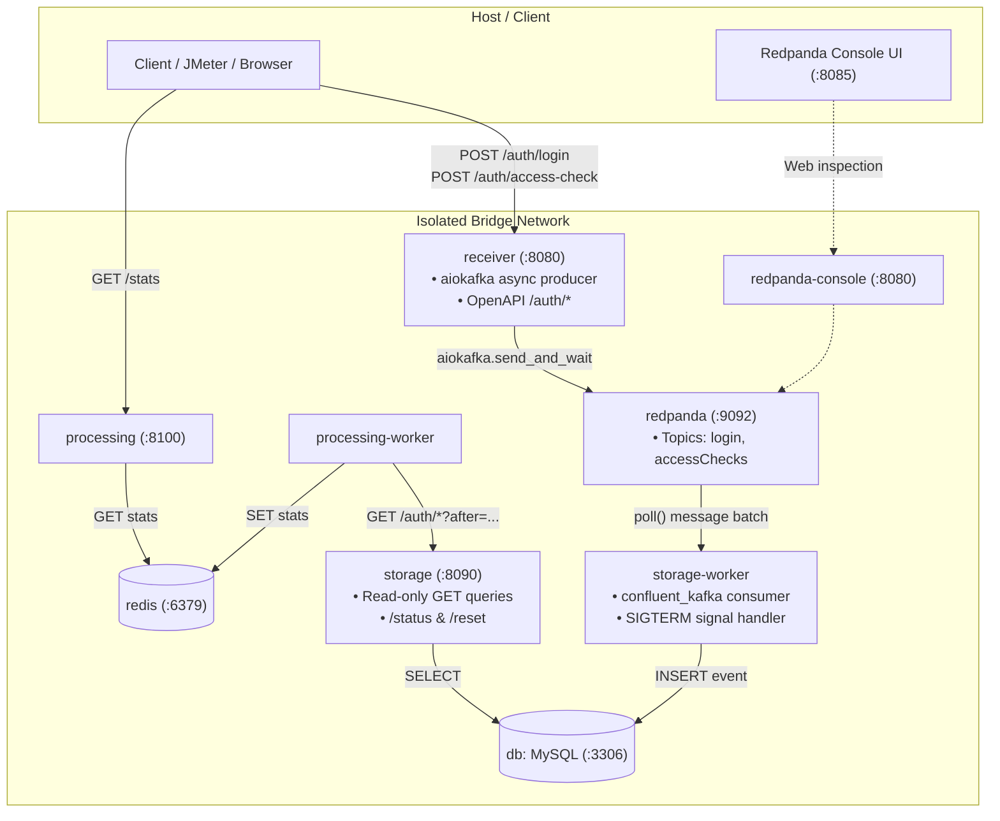

# Lab 9: Asynchronous Message Broker (Kafka / Redpanda) - Roadmap & Architecture Plan

## 1. Objectives & Overview

In Lab 9, we transition our architecture from **synchronous HTTP communication** to **asynchronous message-based event streaming** using Apache Kafka (powered by **Redpanda**).

### Before Lab 9 (Synchronous & Tight Coupling):
$$\text{Client} \xrightarrow{\text{HTTP}} \text{Receiver} \xrightarrow{\text{HTTP POST}} \text{Storage} \xrightarrow{\text{TCP}} \text{MySQL}$$
* **Problem:** If MySQL or Storage slows down, Receiver hangs. If Storage goes down, Receiver fails with HTTP 500.

### After Lab 9 (Asynchronous Decoupled Event Streaming):
$$\text{Client} \xrightarrow{\text{HTTP}} \text{Receiver} \xrightarrow{\text{async produce}} \text{Redpanda (Kafka)} \xleftarrow{\text{sync consume}} \text{Storage Worker} \xrightarrow{\text{TCP}} \text{MySQL}$$
$$\text{Processing Worker} \xrightarrow{\text{GET ?after=...}} \text{Storage API} \xrightarrow{\text{TCP}} \text{MySQL}$$

* **Benefits:**
  - **Temporal Decoupling:** Receiver never blocks on database writes. It responds `201 Accepted` in ~1-2ms once Redpanda acknowledges the message.
  - **Backpressure Buffering:** If Storage Worker stops or restarts, messages safely accumulate in Kafka partitions without dropping any client requests.
  - **Single Responsibility:** Storage is split into a **Worker** (consumes from Kafka and writes to MySQL) and an **API** (serves `GET` reads to Processing).

---

## 2. System Architecture Flow

---

## 3. Step-by-Step Implementation Plan

### Step 1: Verify & Finalize Producer Environment (Docker Compose & Receiver)
- **Status:** Mostly completed in `receiver/receiver.py`.
- **Tasks:**
  - Ensure `docker-compose.yml` explicitly sets both `KAFKA_TOPIC_LOGIN=login` and `KAFKA_TOPIC_ACCESS=accessChecks`.
  - Verify `receiver/receiver.py` publishes properly to both topics.

### Step 2: Implement Storage Worker (`storage/storage_worker.py`)
- **Tasks:**
  - Implement a dedicated synchronous consumer using `confluent_kafka.Consumer`.
  - Subscribes to both topics: `["login", "accessChecks"]`.
  - Determines event type from `msg.topic()`.
  - Deserializes JSON payload and persists to MySQL (`LoginEvent` or `AccessCheck`).
  - Commits message offset with `consumer.commit(msg)`.
  - Implements POSIX `SIGTERM` signal handling for graceful container termination without offset corruption.

### Step 3: Containerize Storage Worker (`storage/Dockerfile.worker`)
- **Tasks:**
  - Build custom image with `python:3.14-slim`, `confluent-kafka`, `sqlalchemy`, `mysqlclient`, `pyyaml`.
  - Run `CMD ["python", "storage_worker.py"]`.

### Step 4: Clean up Storage API (`storage/storage.py` & `storage/storage.yaml`)
- **Tasks:**
  - Remove deprecated `POST /auth/login` and `POST /auth/access-check` routes from `storage.py` and `storage.yaml`.
  - Retain `GET /auth/login`, `GET /auth/access-check`, `GET /status`, and `POST /reset`.
  - Remove unused dependencies (e.g. `requests`).

### Step 5: Update `docker-compose.yml`
- **Tasks:**
  - Define `storage-worker` service in Compose.
  - Set dependencies: wait for both `db` and `redpanda` to be healthy before starting `storage-worker`.
  - Update `storage` (API) service dependencies.

### Step 6: End-to-End Testing & Verification
- **Tasks:**
  - Bring up entire stack with `docker compose up -d --build`.
  - Access Redpanda Console at `http://localhost:8085` and inspect topic partitions.
  - Run JMeter load tests (`./run_jmeter.sh 10 5`).
  - Verify message offsets in Kafka, row counts in MySQL, and live aggregate stats in Processing (`http://localhost:8100/stats`).
